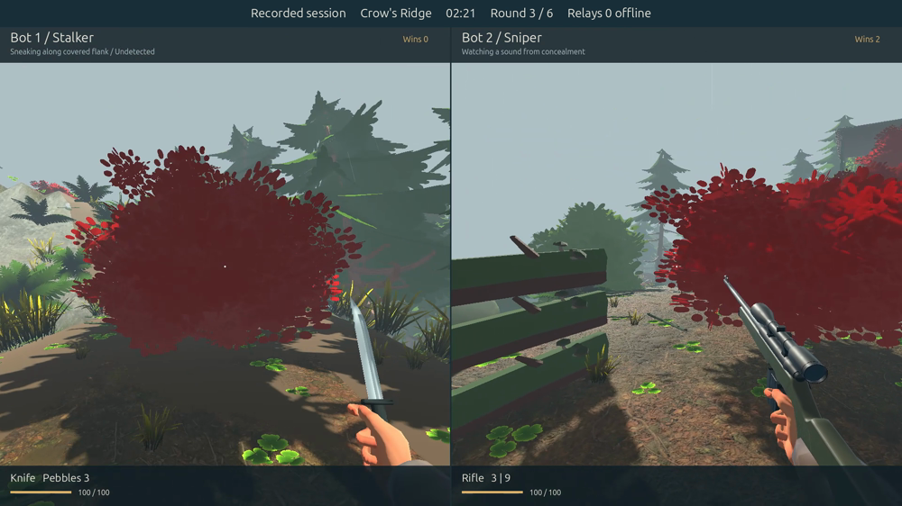

# Close the Gap

A two-player 3D stealth duel for Windows, built with Godot 4.7.2. One player approaches with a knife and aimed handgun; the other hides and relocates between elevated sniper positions. Roles swap every round.

[Download the Windows demo](https://github.com/sbenson2/close-the-gap/releases/download/v0.1.0-demo.1/Close-the-Gap-Demo-Windows.zip) · [Watch 1080p/60 fps gameplay](https://github.com/sbenson2/close-the-gap/releases/download/v0.1.0-demo.1/Close-the-Gap-Demo-60fps.mp4) · [Release notes](docs/demo-release.md)



## Play with a friend

1. Both players download and extract the same Windows ZIP.
2. Run **CloseTheGap.exe** in the extracted **Close-the-Gap** folder. Keep the PCK beside it; Godot does not need to be installed.
3. Host chooses **Host a game**, selects the map, rules, conditions and match length, then creates and copies a private invite.
4. Friend opens **Join a game**, pastes the invite and joins.
5. Both press **Ready**. Quick matches have two rounds; Full matches have six. Either player can request a rematch.

Friend mode attempts direct peer connectivity and falls back to a relay. It uses the free, open-source Noray community test service; gameplay authority stays on the host PC. No account, Steam installation or manual port forwarding is needed for the normal invite flow. The community service has no availability guarantee, and networks blocking outbound UDP may prevent a connection. Keep invites private.

## Demo contents

- **Crow's Ridge:** a wooded mountainside with seven linked elevated positions, covered uphill routes and a western handline.
- **Pine Hollow:** forest, tall grass, shrubs, rocks, wandering animals and birds that react to nearby movement and gunfire.
- **East Yard:** freight containers, loading platforms and screened approaches.
- **Paired duel:** eliminations, a 150-second draw timer and complete role pairs. Rear knife hits are lethal; frontal hits deal 35 damage. The rifle has three rounds and nine reserve.
- **Relay infiltration:** sabotage two physical stations to start a repair deadline. The sniper can repair; eliminations still win. Each station can be sabotaged once and permanently repaired once.
- **Classic:** first to three wins, lethal knife hits from any angle and unlimited rifle ammunition.
- Wind/rain, material footsteps, fading mud tracks, reflector decoys, tripwire alarms, glint-free binocular observation and three pebble distractions.
- Practice against either bot role, two weapon lessons, F1 field guide, keyboard remapping, captions, FOV/settings, local field journal, round reviews and saved dual-view match recordings.

Bots react to verified sightings, approximate audible areas and directly visible physical evidence. They receive no hidden opponent coordinates or enemy-spawn prior. Ground-truth telemetry is separate from their decision inputs.

## Controls

| Input | Action |
| --- | --- |
| WASD / mouse | Move / look |
| Left mouse / right mouse | Attack / aim or scope |
| Shift / Ctrl / Space | Sprint / crouch / jump |
| 1 / 2 | Knife / handgun, stalker only |
| R / G | Reload / throw pebble |
| Q / T | Reflector, stalker / tripwire, sniper |
| B | Hold sniper binoculars; release before firing |
| E | Hold sabotage/repair, or use the western handline |
| Tab / F1 / Esc | Own-position map / guide / menu |

Online rounds continue while a menu is open. Settings can change keyboard bindings. After a match, **Save match recording**, then **Watch → Your recordings** to replay both viewpoints locally. Recordings do not contain invite secrets or connection credentials.

## Open and build the source

Clone this repository normally; all required models, textures, audio and recordings are included, without Git LFS or asset-download scripts. Open `project.godot` in **Godot 4.7.2** and press F5. The game opens at Play.

For a Windows build, install the matching export templates in Godot, then use **Project → Export → Windows**, or:

```sh
mkdir -p builds/windows
godot --headless --editor --path . --import --quit
godot --headless --path . --export-release Windows builds/windows/CloseTheGap.exe
godot --headless --path . --script res://tools/export_notices.gd
python3 tools/package.py --platform windows --label Demo
```

The Windows ZIP must include the engine and asset license notices. Game source also opens on Linux and macOS; the downloadable player build targets Windows x64.

## Checks and limitations

```sh
godot --headless --editor --path . --import --quit
python3 tools/check_game.py --godot godot --out artifacts/regression
python3 tools/test_mountain_network.py --godot godot --suite demo --out artifacts/network
```

CI imports the project and runs the source suite. The second command above includes 31 suites: 384 counted Godot checks, rules checks and five Python analysis tests. The network command uses two local clients; it does not contact the public service. Public service tests are separate and must be run deliberately.

The published demo also passed packaged-content checks, native Windows six-round/rematch and recording tests, and separate 12-round paired/relay bot cohorts. The gameplay video is the complete third round of five, selected by index: 3,715 decoded frames at constant 60 fps with audio. [Verification details](docs/demo-release.md) distinguish automated coverage from human playtesting.

This is a demo: remote poses update at 20 Hz, local movement is predicted, and hits have no historical rewind. Latency can affect shot feel. Two physical PCs on separate home networks and human enjoyment/balance still need playtesting. Short repeated native samples averaged about 95 fps for one view and 68 fps for split screen at 1080p with rain on an i9-9900 / RTX 4060; an initial cold split-screen run had a 1.13-second hitch. These measurements are not a sustained or locked-60 guarantee.

## Contributing and licenses

See [CONTRIBUTING.md](CONTRIBUTING.md) for changes and bug reports, and [SECURITY.md](SECURITY.md) for private vulnerability reporting. Code and original project content use the [MIT license](LICENSE). Imported assets retain their own CC0, CC BY 4.0 and Ubuntu Font licenses; [CREDITS.md](CREDITS.md) names authors, sources and modifications. The release includes the Godot engine's notices. No paid assets or proprietary game/decompilation content are included.
