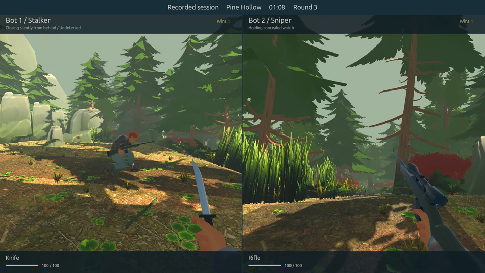

# Bot AI implementation and gameplay study

The sniper now hides on restricted high ground, chooses reachable cover with a useful firing peek, holds an approach and withdraws or relocates after shooting. The stalker selects risk-aware routes, waits before dangerous crossings when it has relevant observations, adapts to the observed rear on the ridge/deck, and searches static candidate perches. Both roles use their own remembered evidence.

## Verification

The full source runner passes 234 counted Godot checks plus the rules suite, and four Python analysis tests. New cases cover pitch/zoom sight, hearing before first sight, fresh sight versus vague cues, audible shots without visual lock, actual useful hides, covered route alternatives, confidence decay, practice search without another AI, secondary covered observation fallback, adaptive rear approach, exhaustive secondary search and the visibility-query budget. Recorder early completion is compatible and idempotent.

An independent read-only review found the practice-cache and covered-fallback cases; both have failing-then-passing regressions. Planning telemetry exposed 100+ ms path requests and a stale authored waypoint after acquiring the sniper. The reproduced request fell from 84.364–96.452 ms to 4.952–6.052 ms after bounding expensive queries at 256 per request. Disabling the cap reproduces the budget regression failure. These measurements describe CPU queries, not live rendering frame rate.

## Experiment design

Development used eight baseline rounds, eight pilot rounds, 48 pre-review rounds, a four-round profile reproduction and 48 accelerated validation rounds. A startup-timing mismatch was then identified: the batch shortened countdowns while normal playback and recording did not. The reported comparison therefore uses a separate eight-round original-code baseline and 48 upgraded rounds with the normal countdown. Earlier accelerated batches are retained as exploratory evidence. Each 48-round batch uses 12 seeds (71 + 137 × index), both maps and both role assignments. Final data and source hashes identify the tested policy. Raw traces sample position, aim, state, visible contact, cue type/age/radius and path activity at 4 Hz. The five-round replay records interpolatable player state at 20 Hz and attacks/bird events at 60 Hz.

Baseline comparisons use only matching map/seed/assignment pairs. The expanded seed set is reported separately. Stationary time does not itself prove concealment; actual cover and useful peeks have separate physical regression tests. Seen/stall estimates have 0.25-second sampling resolution. Bot outcomes do not establish human balance or enjoyment.

## Saved session and video

The new `replays/ai-session.json` contains five consecutive forest rounds at seed 71. The third completed round is selected by index, regardless of winner, for `Close-the-Gap-Middle-Round-60fps.mp4`. The complete five-round source replay, round-selection ticks, source hash, recorded events and study telemetry are retained. Older recordings and videos are preserved.

The native Windows renderer uses the RTX 4060, two full-resolution POVs, the saved replay and the established fixed 60 fps audio/video pipeline. Rendering stays offscreen and unfocused. The game does not rerun AI when replaying or making the video.

## Reproduce

```sh
python3 tools/check_game.py --godot /path/to/godot
godot --headless --fixed-fps 60 --path . --script res://tools/run_bot_study.gd -- res://artifacts/ai-upgrade/reproduction 12
godot --headless --fixed-fps 60 --path . --script res://tools/record_bot_study.gd
python3 tools/analyze_bot_study.py --study artifacts/ai-upgrade/reproduction/results.json --replay replays/ai-session.json --out artifacts/ai-upgrade/analysis
python3 tools/render_windows_movie.py prepare
python3 tools/render_windows_movie.py study --selection artifacts/ai-upgrade/analysis/round-selection.json
```

Native rendering helpers describe this Windows/WSL machine; gameplay/source are portable Godot. Detailed local logs stay under `artifacts/ai-upgrade`. A separate data ZIP contains the shareable reports, CSV, raw study results/traces, source snapshots, policy hashes and the full replay without the model archives.

## Results

All development, validation and recording together completed **177 rounds**, totaling **170.9 minutes of active round time**. This total includes repeated seeds across policy versions; the final comparison uses 48 rounds across 12 seeds, not 177 independent samples.

| Map | Final rounds | Stalker / sniper wins | Unseen knife finishes | Median round | Sniper stationary |
| --- | ---: | ---: | ---: | ---: | ---: |
| forest | 24 | 10 / 14 | 5 | 81.76 s | 89.0% |
| yard | 24 | 0 / 24 | 0 | 46.43 s | 86.7% |

Every final round resolved through combat: zero timeouts, unfinished rounds or sampled high-ground violations. The forest produced five knife finishes with zero sniper visual acquisitions. On the eight matched baseline cases, forest wins stayed 2/2 while the sniper's stationary fraction rose from 6.8% to 87.7%; yard outcomes changed from four stalker wins to four sniper wins. The expanded cohort is separate from that small paired comparison.

The yard is strongly sniper-favored in this bot sample (24/24). This is a remaining balance finding, not evidence of fair human matchups. The forest supports both winners, with the intended unseen rear finish demonstrated. Human playtests should evaluate discoverability and opportunity before changing aim accuracy or scoring solely to force equal bot wins.

The normal-countdown study reproduces the first two rounds of the saved session, with result agreement and round durations within 0.003 seconds. Both datasets have the same controller hash. Comparison tooling now rejects datasets with differing countdown settings. Detailed tables/CSV are in the data bundle's `analysis` directory.

The selected video is exactly **91.8 seconds, 1920×1080, 5,508 constant-60-fps frames**. All frames decoded; a three-second motion sample contains 180 distinct decoded frames. Stereo AAC decoded with mean −45.0 dB and peak −6.0 dB. Encoded stills at approach, watch and elimination were visually inspected. File size: 264,619,959 bytes; SHA-256 `f2d1f7ab4e70d118ad208fa0f024564849c76b3d5d7cb5d1eb3702fcc2a448ca`.

The complete replay is 450.283 seconds, 9,009 states and 19 events over five consecutive rounds; the third round has zero sniper visual acquisitions and ends in a rear knife elimination. Replay SHA-256 `5cabc398a68b8caf7855affdadf219036bc570250b790ce8b6af547760e95a98`. Older replay/video files are unchanged.

The Windows export has zero errors/warnings. Exported-pack tests pass for models (69), tactics (14) and the featured session (6). The actual Windows executable boots the saved session and completes real live bot combat headlessly. LAN integration passes 28 checks. All graphical validation and rendering stayed offscreen/unfocused. Live minimum FPS, subjective audio quality and human balance are not established by these checks.



Primary research and its evidence boundaries are in [bot AI research](bot-ai-research.md).
