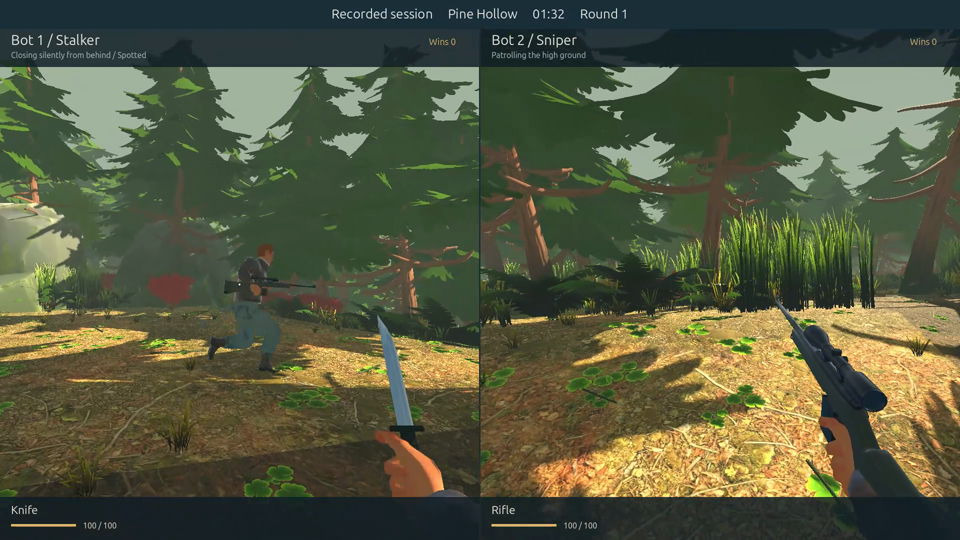

# Authored asset replacement

Updated 2026-11-02. The visible prototype trees, plants, rocks, logs, stumps, mushrooms, character bodies, first-person arms, weapons, animals, birds and yard structures now use artist-made model assets. The result is textured low-poly art. Terrain/trails, invisible collision and transient effects remain engine geometry. The forest slope, routes, concealment, animal paths, bird clues, combat, networking and recording are preserved. Graphical checks stayed offscreen.

## Sources and licenses

[CREDITS.md](../CREDITS.md) lists authors, direct source pages, licenses and modifications. `assets/models/SOURCES.json` records original download names, sizes and SHA-256 hashes, plus the shipped model hashes. Only free Standard portions of the Quaternius packs were acquired. No paid assets or downloaded add-on scripts were installed.

- Quaternius Stylized Nature MegaKit Standard: 25 selected original glTF models and their dependencies; trees, bushes, ferns, grasses, plants, mushrooms and rocks. CC0.
- Quaternius Ultimate Nature Pack: original log/stump FBXs. CC0.
- Diesel by THEUNSEENVULGA: textured, 65-bone human. CC0. Twelve Quaternius Universal Animation Library Standard clips retargeted onto 52 matching bones; crouch, movement and death use skeletal motion. First-person forearms are derived from the same authored mesh.
- Guns & Explosives by 3dmodelscc0: sniper rifle and Makarov with restored supplied PBR maps. CC0. SkywolfGameStudios CC0Tree combat knife: missing palette replaced with steel/rubber materials. CC0. Clean GLBs ship at runtime; original weapon sources stay in `source_art/weapons`, excluded from Godot import and export.
- Quaternius deer, stag and fox: same-author CC0 animated GLBs from Poly Pizza mirrors because the original download service had exhausted its quota. Original model files are unmodified.
- PSX Animals Free by heyheythere: original rigged crow and rabbit with atlas and animations. CC BY 4.0; attribution and full license included.
- PSX Industrial Environment by godgoldfear: twelve extracted components for buildings, barriers, crates, stairs, platforms and structural details. CC BY 4.0; attribution, changes and full license included. Shipping Crates by loafbrr: selected container with supplied PBR maps, CC0.

## Implementation

`scripts/model_assets.gd` caches model scenes and baked mesh surfaces. Vegetation keeps original textures, uses local MultiMesh batches and a textured wind shader. Render fitting changes visuals independently of collision. Wildlife and birds sample their supplied skeletal animations on the existing paths. `scripts/character_visual.gd` handles imported humans and first-person grip poses.

To regenerate weapons and retargeted clips after importing the source project:

```sh
godot --headless --path . --script res://tools/prepare_model_assets.gd
godot --headless --path . --script res://tools/prepare_model_assets.gd -- --yard-only
godot --headless --editor --path . --import --quit
```

The raw upstream weapon FBXs reference omitted/stale textures and can emit texture warnings during the preparation command. Preparation explicitly restores the supplied maps/materials; normal project import and game execution use the repaired GLBs. No warning suppression is used.

## Verification

A comparison against the original scripts confirms byte-equivalent solid-obstacle descriptors, concealment areas, tree perches and stalker route. All 12,686 foliage placements are retained. Layout SHA-256: `0d10b291d04ebb2270de2a1c533a26f097a0dc7aa8a3348c8e871ca540b918aa`. The recording remains unchanged.

Offscreen native Windows captures inspected the forest encounter, handgun iron sights, wildlife and yard through both actual POVs. The wildlife close-up is deliberately staged to inspect the imported model. A six-second uncapped 1920×1080 split-screen replay sample on the RTX 4060 rendered 371 frames: mean 61.76 fps, median 16.182 ms, 95th percentile 17.253 ms. It is a short sample, not a guaranteed minimum. Art adds geometry workload; further performance work should profile representative live matches.

A separate 30-second 1080p60 preview uses the saved replay from 55–85 seconds. The original ten-minute MP4 is preserved and still shows the previous art. Reproduce the short preview with `python3 tools/render_windows_movie.py prepare` followed by `python3 tools/render_windows_movie.py preview` on this Windows/WSL workstation. This does not rerun the bots or change the recording.

Detailed local evidence is under `artifacts/asset-research`, excluded from the downloads. Regression, export and package results are recorded in [verification.md](verification.md).

## Captures



[Handgun iron sights](images/asset-handgun.png) · [Industrial yard](images/asset-yard.png) · [Animal model inspection](images/asset-animals.png).
