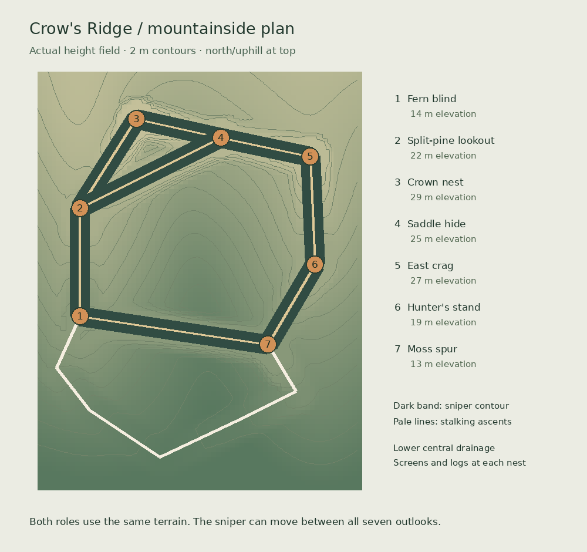
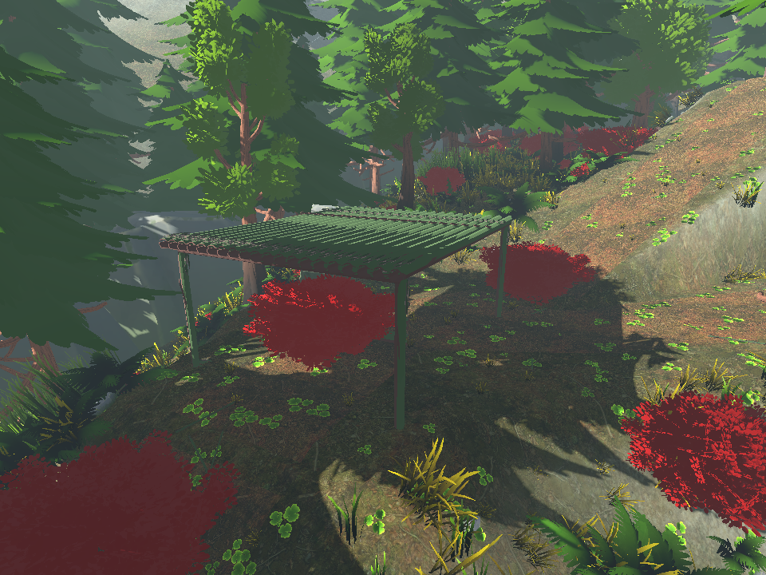
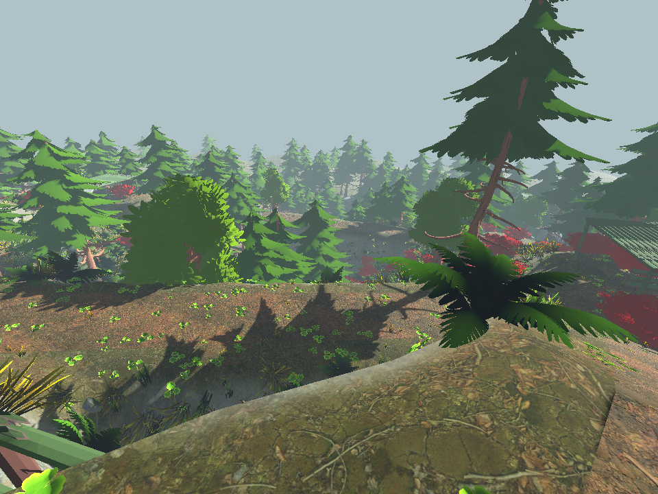

# Crow's Ridge: mountainside layout

Intent: a sniper hides above a wooded drainage, changes outlooks along the high contour, and risks exposing a silhouette while moving. The stalker reads the landscape, climbs through hollows, and reaches the rear of a nest. Seven outlooks replace the single northern firing line on this new map. Pine Hollow stays intact for existing recordings.

The 68 × 88 metre playable footprint contains an asymmetric horseshoe of ridges, a lower central drainage, two climbing flanks and a rear saddle. Heights are authored rather than unrestricted noise. A continuous contour path links all seven outlooks. Each has a screened rear entrance, crouching cover, a separate standing firing edge and at least two onward directions through the high-ground network (end overlooks connect back through a second cross-link). Timber platforms sit on rocky spurs and meet the hillside at the rear; no ladder or teleport is required.

| Outlook | Position (x,z) | Height | Role |
| --- | --- | --- | --- |
| Fern blind | -25, 8 | 14 m | Western lower crossing |
| Split-pine lookout | -25, -15 | 22 m | Western ascent and drainage |
| Crown nest | -13, -34 | 29 m | Long southern view; exposed silhouette |
| Saddle hide | 5, -30 | 25 m | Short cross-ravine view; covered transfer |
| East crag | 24, -26 | 27 m | Eastern ascent and cross-slope lane |
| Hunter's stand | 25, -3 | 19 m | Eastern forest and lower crossing |
| Moss spur | 15, 14 | 13 m | Low forward ambush; weak distant view |

The sniper's permitted area follows the connected high paths and outlooks, rather than a rectangle across the back of the map. Both players use the same physical terrain and collision. The stalker can use all of these routes. Trees and rocks stay clear of the path corridor; foliage gathers in hollows and behind cover, with gaps at firing edges. Crows and animals remain active.

Verification targets: all outlooks connected for both roles, real capsule movement along the contour and both uphill flanks, no low-basin sniper access, useful firing rays paired with crouched cover, deterministic peer layout, saved Pine Hollow playback unchanged. Bot trials log outcomes, visits, movement, stalls and boundary violations. Human stealth readability and enjoyment remain playtest questions.

Sources informing the design: Epic's [Level Design Best Practices](https://dev.epicgames.com/documentation/fortnite/level-design-best-practices-in-fortnite-creative) recommends readable connections, alternate exits and broken outdoor sightlines; its Fortnite context is broader than this duel. The game-development skill's levels reference motivates testing movement metrics and sightlines before adding decoration. The specific horseshoe layout and heights above are this project's design hypotheses.

Evidence and iteration results are recorded in `artifacts/mountainside/progress.md` and below.

## Review images

The plan below is generated from the game's height field and authored route graph. It is not a concept image.







## Reproduction

Use Godot 4.7.2. All simulation commands below run headlessly; native Windows previews and movie rendering stay offscreen.

```sh
python3 tools/check_game.py --godot /path/to/godot --out artifacts/mountainside/final-regression
python3 tools/test_mountain_network.py --godot /path/to/godot
godot --headless --fixed-fps 60 --path . --script res://tools/run_bot_study.gd -- res://artifacts/mountainside/final-study 6 71 --mountain
godot --headless --fixed-fps 60 --path . --script res://tools/record_bot_study.gd -- mountain res://replays/mountain-session.json 5
godot --headless --path . --script res://tools/audit_mountainside.gd
uv run --with pillow==12.0.0 python tools/draw_mountainside_plan.py
```

The game itself has no Pillow dependency. It is only used to draw the terrain plan.

## Bot information boundary

Bots may use direct sight and approximate sound cues only. The decision controller holds its own actor, static map geometry, a perception interface and an attack callback; it has no opponent object or game roster. `bot_senses.gd` is the engine-side visibility/hearing layer. It releases position, facing and motion estimates only after a view-cone, physical line-of-sight and foliage test. Lost sight freezes the last observation; it does not update a hidden target. Bots retain fading memory of observations.

There is no enemy-spawn fallback or initial positional confidence. Gunshots and audible footsteps produce a six-metre quantised sound area with a seven-metre uncertainty radius; height comes from the map at the estimate. A separate sensory random stream prevents unseen state from perturbing decision randomness. Sound is capped at low-confidence search knowledge and never grants a firing lock. Birds point to the disturbed tree, not a hidden player coordinate.

The information regression moves a silent opponent between three locations behind a wall and compares thirty decision ticks. Movement, aim, route, hiding plan, target memory and random state must remain identical. Separate awareness tests verify that actual visible targets and audible shots still work.

The final cover pass adds real shrub patches to the quiet climbs and selected contour transfers, with rear screens at the outlooks. Gaps leave firing opportunities. A confirmed sighting across the valley no longer makes the knife bot abandon its flank: final rear pursuit starts within 12 m of the observed estimate. Rifle bots require a sustained1.2s acquisition of a visible crouched silhouette; standing targets retain the earlier0.6s delay. These delays use confirmed visible appearance only.

## Verification results

- Seven elevated outlooks, all reached by the real crouched character controller in a complete contour loop. Both lower flanks are also physically traversable. Every outlook has a qualified hiding/firing plan.
- 264 counted Godot checks, rules and four Python tests pass. The19-suite report is `artifacts/mountainside/final-checks.json`; it records the focused rerun after isolating two synthetic contact scenarios from path-cache hysteresis.
- Seven checks pass with two actual loopback clients, including identical shrub concealment, geometry and bird perches, replicated bird cues and host-enforced high-ground limits.
- The exported PCK passes the map15, information9 and featured-replay7 checks when run outside the source project. The actual Windows executable boots recorded playback and completes a live combat round headlessly. Final export and runtime logs contain no errors or warnings.
- Fifteen seconds of native Windows live split-screen at 1920×1080 on the RTX 4060 averaged 71.0 fps; median 14.04 ms,95th percentile 17.70 ms. This short sample does not establish a sustained minimum.
- The saved session contains five completed normal-timing rounds over351.717s. The complete third round was selected by index independently of outcome:43.367s,2602constant60fps frames,1920×1080, stereo AAC. All frames decode, and 180/180 motion samples are distinct. Video SHA-256: `ae60e8ec5fe4828d905aeb54a3113cbdae0ef31190304d762f94dc19266ff610`. Replay SHA-256: `f59c348fc900b2c798e6f70d797b0a339383b1dc7fd9746895a0217bdfc5027b`.

The final twelve-round cohort uses six seeds and both role assignments. All twelve resolve by rifle elimination; median duration is56.18s. There are no timeouts, unfinished rounds, high-ground violations or unresolved waypoint arrivals. Total transient requested-movement stalls are4.5s for the stalker and2.5s for the sniper across the entire cohort. These are automated coverage results, not human balance validation.

**Balance finding:** the current bots favor the sniper: 12 wins to 0. They mostly use Saddle hide and East crag, visiting a median of two outlooks per round. The remaining five outlooks are physically verified and available to human players, but the cohort does not demonstrate varied AI use of all seven. Shrub cover and the corrected flank rule preserve stealth opportunities without granting hidden information; the bot match results still require further balance review. No unseen knife finish occurred in this final cohort.

Earlier open-approach and perception experiments remain labelled in the data bundle. All original Pine Hollow replay files and older videos have unchanged hashes. Normal launch opens the new mountainside recording; Live bots starts a fresh duel.
